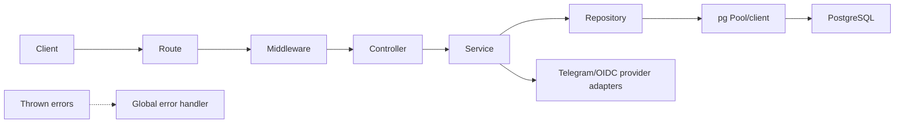
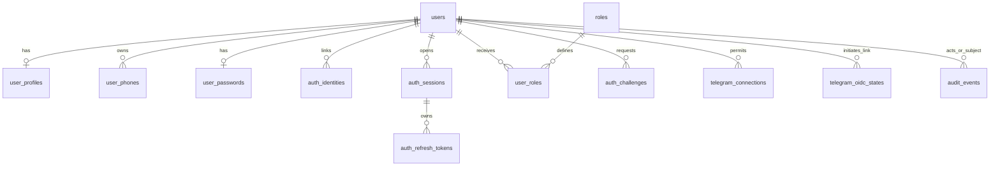
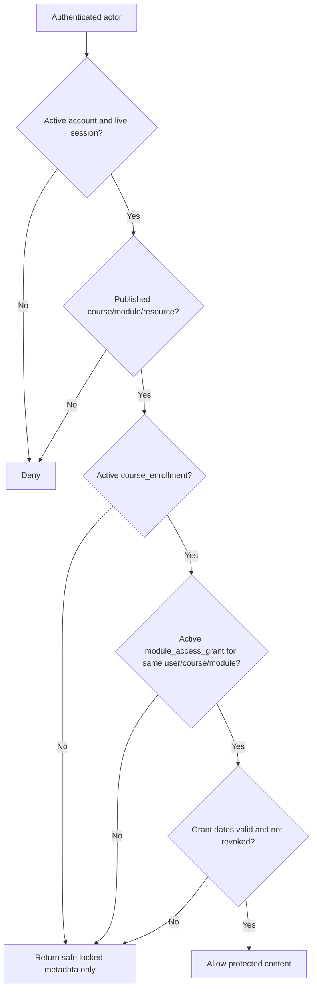
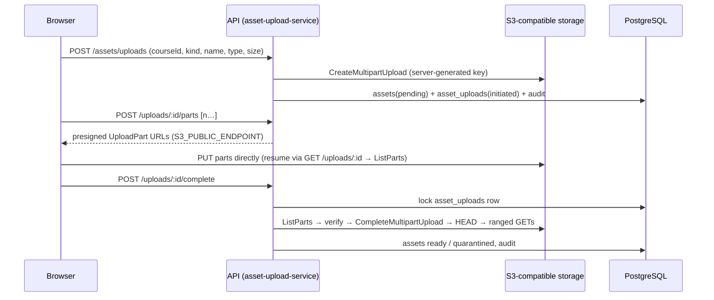
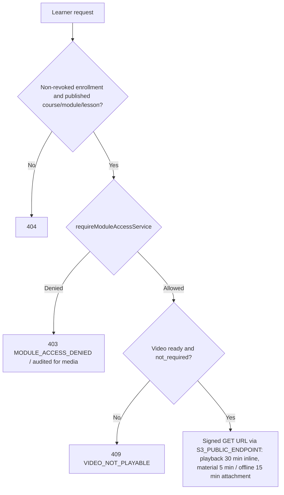
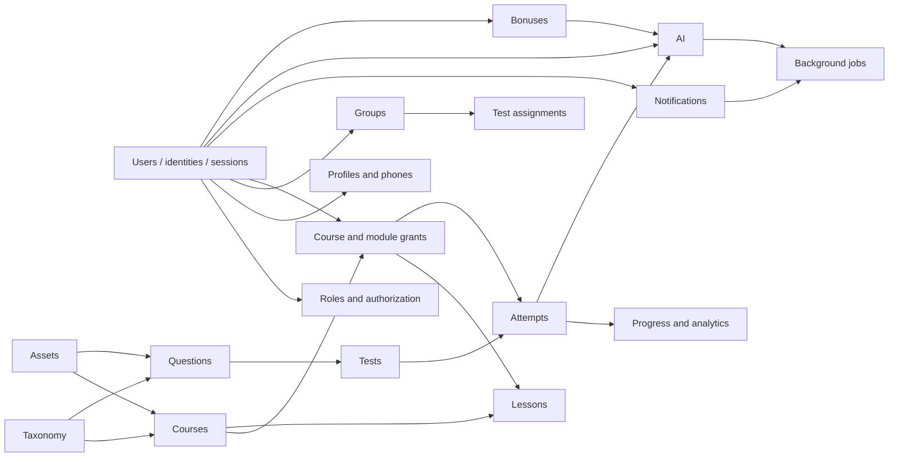

# EVEREST Backend Architecture

Status: current-state audit. Last verified: 25 October 2026 (Asia/Dushanbe).

This document is the single source of truth for the architecture **implemented in this repository today**. `AGENTS.md` remains the source of mandatory engineering rules, while `schema_tables.md` remains the detailed database baseline contract. This document records what exists, what is partial, and what is only planned; a table existing in PostgreSQL is not evidence that its API or business service exists.

Evidence used for this audit: actual source files, all migrations, `package.json`, `package-lock.json`, the database catalog, tests and scripts, `docs/api.md`, `docs/decisions.md`, `docs/progress.md`, `schema_tables.md`, `documentation.md`, project-local skills, and Git state. No secret values were read into this document.

## 1. Project overview

EVEREST is a closed learning platform for one education center. Its intended domains include users, groups, courses, individually granted course/module access, recorded lessons, question banks, tests, progress, notifications, AI assistance, bonuses, and operational jobs.

The current backend is a small layered modular monolith. The foundation, full database schema, health/readiness API, and Telegram OpenID Connect authentication/linking increment are implemented. Most other product domains currently have database schema only.

| Concern | Current implementation |
|---|---|
| Language/runtime | JavaScript on Node.js `>=22 <23` |
| Module format | Native ES modules (`"type": "module"`) |
| HTTP | Express 5.3.0 |
| Database | PostgreSQL 16.10 through `pg` 8.23.1 |
| Migrations | `node-pg-migrate` 8.0.4, JavaScript/raw SQL |
| Security/token library | `jose` 6.2.13 |
| Configuration | `dotenv` 17.4.2 and validated readers in `src/configs/env.js` |
| Tests | Node's built-in test runner plus PostgreSQL integration/verification scripts |
| Current milestone | M06 course enrollments and module access complete; M07 lessons and protected assets planned next |

## 2. Repository tree

Generated dependencies, `.git` internals, `.npm-cache`, and `.env` are intentionally omitted.

```text
everest-backend/
├── .agents/skills/everest-backend/       # Codex project skill and rules
├── .claude/skills/everest-backend/       # Identical Claude Code skill copy
├── docs/
│   ├── api.md                             # Implemented HTTP contracts
│   ├── architecture.md                    # This audited architecture source
│   ├── decisions.md                       # Accepted dated decisions
│   └── progress.md                        # Implementation handoff/history
├── scripts/
│   ├── inspect-database.js                # Read-only target/catalog summary
│   ├── test-migration-cycle.js            # Disposable DB up/down/up test
│   ├── test-schema-integrity.js           # Constraint tests rolled back in one transaction
│   ├── test-server.js                     # Health/readiness/shutdown integration test
│   ├── verify-database.js                 # Expected catalog/count verification
│   └── verify-migration-sources.js        # Baseline SQL digest/integrity verification
├── src/
│   ├── configs/                           # Environment, Pool, errors, migration runner
│   ├── controllers/                       # Health and Telegram HTTP adapters
│   ├── middleware/                        # Current session authentication middleware
│   ├── migrations/                        # 12 baseline + 1 incremental migration
│   ├── repositories/                      # All runtime application SQL and transactions
│   ├── routes/                            # `/api/v1` and auth route wiring
│   ├── services/                          # Health and Telegram business/application logic
│   │   └── auth/                          # OIDC, Bot API, and session-token adapters
│   ├── utils/                             # AppError, async handler, Telegram crypto
│   ├── app.js                             # Express application composition
│   └── server.js                          # Listener lifecycle and graceful shutdown
├── tests/
│   ├── integration/telegram-auth.test.js  # HTTP + real PostgreSQL, mocked Telegram
│   ├── unit/telegram-crypto.test.js
│   ├── unit/telegram-oidc-provider.test.js
│   └── all.test.js
├── .env.example                           # Empty configuration template
├── .gitignore                             # Excludes `.env`, dependencies, logs, uploads
├── AGENTS.md                              # Shared mandatory agent rules
├── CLAUDE.md                              # Adapter importing `AGENTS.md`
├── documentation.md                       # Broad design/reference document
├── schema_tables.md                       # Exact 81-table baseline schema contract
├── package.json
└── package-lock.json
```

`src/jobs/`, `src/prompts/`, and `src/uploads/` are approved future architectural locations. They will be created only with the corresponding feature because Git does not preserve empty directories. Their current absence is not an architecture violation; jobs, prompts, and uploads are unimplemented.

## 3. Application entry points

`src/app.js` creates Express, disables `x-powered-by`, enables credentialed CORS for configured origins, installs a 1 MiB JSON parser, mounts `/api/v1`, then installs not-found and global error handlers. Importing it constructs an app and Pool-backed service objects but does not listen, migrate, query the database, or launch work.

`src/server.js` is the executable entry point. `start()` first calls the readiness service, then listens on `env.port`. It optionally registers `SIGTERM` and `SIGINT`. Graceful shutdown stops accepting requests, waits up to `SHUTDOWN_TIMEOUT_MS`, closes all connections on timeout, and calls `pool.end()`. Startup failure also closes the pool. Jobs are not started because no job runtime exists.

Routes under `/api/v1` are:

- `GET /health`: process liveness only; no database access.
- `GET /ready`: repository-owned `SELECT 1` readiness check.
- `POST /auth/register`: transactional pending-student phone/password registration.
- `POST /auth/login/password`: active-account password login and session issuance.
- `POST /auth/refresh`, `/auth/logout`, and `/auth/logout-all`: refresh rotation and revocation.
- `GET /auth/sessions` and `DELETE /auth/sessions/:sessionId`: owned multi-device session management.
- `POST /auth/password-recovery/{request,verify,reset}`: non-enumerating recovery lifecycle.
- `/auth/*`: Telegram routes described below.
- `GET /admin/users/pending`: owner/admin pending-account listing.
- `POST /admin/users/:userId/{approve,reject,block,unblock}`: locked and audited account-state transitions.

## 4. Layered architecture



| Layer | Owns | Must not own | Audit result |
|---|---|---|---|
| Routes | Endpoint paths, HTTP verbs, middleware/handler order | Business rules, SQL | Conformant |
| Middleware | Bearer/cookie extraction, authenticated actor resolution | Trusting client `user_id`, SQL | Conformant; only authentication exists |
| Controllers | Query/header/request adaptation and response/cookie writing | Persistence or transaction decisions | Conformant |
| Services | Business rules, provider orchestration, transaction scope, safe DTOs | SQL and Pool/client lifecycle | Conformant |
| Repositories | Parameterized runtime SQL, locks, persistence, transaction helper | HTTP/provider behavior | Conformant |
| Migrations | DDL, functions, triggers, indexes, role seeds | Runtime business workflows | Conformant |

`withTransaction()` acquires one client, issues `BEGIN`, invokes the service callback, commits or rolls back, and releases in `finally`. Telegram link/login/unlink services pass that same client to every transaction-only repository method. No runtime application SQL or `.query()` call was found outside repositories; tests and operational scripts are intentional exceptions. No CommonJS usage was found.

Validation is currently lightweight and service-owned: password-auth request shape, E.164/name/password rules, Telegram intent, callback state/code, configuration, verified claims, account state, session state, identity conflicts, unlink safety, pagination, canonical account IDs, and permission-code form are checked in services/providers. There is no general request-schema validator. M02F-A adds reusable database-backed action authorization and applies it to account administration; unresolved domain/resource authorization remains planned.

Errors propagate through `asyncHandler` or explicit middleware `try/catch` to the global error handler.

## 5. Database connection architecture

`src/configs/db.js` creates one process-wide bounded `pg.Pool` from `env.database`. Current defaults are pool maximum 5, connection timeout 5 seconds, and idle timeout 30 seconds. An idle-client error logs only its error code.

`DB_HOST`, `DB_NAME`, `DB_USER`, and `DB_PASSWORD` are mandatory at configuration import. `DB_PORT` defaults to 5432. `DB_SSL=false` uses plaintext PostgreSQL transport; when true, `ssl: { rejectUnauthorized: true }` is used. No certificate-verification bypass is present.

Ordinary one-statement repositories may use the Pool. Atomic multi-statement work uses the single client supplied by `withTransaction`; entity repositories do not release it. `server.js` closes the Pool during graceful shutdown.

Tests do **not** currently use a separately configured integration-test database. Integrity tests use a direct `pg.Client` against the configured development database and roll back their transaction. Authentication integration tests create unique fixtures and delete them in `finally`. Migration rollback verification uses a separately named disposable database that is created, migrated up twice, rolled down once, reapplied, and dropped.

## 6. Migration architecture

Migrations live in `src/migrations/` and use native ESM with raw SQL. Required style:

```js
export const up = pgm => {
  pgm.sql(`
    -- SQL
  `)
}

export const down = pgm => {
  pgm.sql(`
    -- exact reversible SQL
  `)
}
```

The programmatic runner in `src/configs/migrate.js` uses the shared DB configuration, `pgmigrations`, ordering checks, migration locking, and a single transaction. `npm run migrate:up` applies all pending migrations. `npm run migrate:down` is limited to one migration and refuses database names that do not clearly contain `test`, `tmp`, `temp`, or `disposable`.

Internal entity identifiers are PostgreSQL `BIGINT GENERATED BY DEFAULT AS IDENTITY`; repositories omit them on insert and consume `RETURNING id`. Foreign keys, one-to-one identifiers, composite relationship identifiers, database-function parameters, and polymorphic audit identifiers use `BIGINT`. Because `pg` preserves `BIGINT` as strings, API and JWT user/session identifiers are validated positive decimal strings and are never converted through JavaScript `Number`. Sequence gaps are valid. The only UUID column is `sms_deliveries.idempotency_key`, an opaque retry key rather than an entity identifier.

There are 20 applied migrations: 12 baseline files plus Telegram OIDC, password recovery, RBAC permissions, M02F-B authentication-protection state, M04-B group permission seeds, M05-A course permission/edit-scope state, M05-B module/copy permission seeds, and M06 course-access permission seeds. The earlier 19 files are published and must not be edited. Legacy hyphen separators still cause harmless node-pg-migrate timestamp warnings.

Verified development catalog:

| Object | Count |
|---|---:|
| Application tables | 85 |
| Columns | 669 |
| Foreign keys | 159 |
| Indexes, including constraint-backed | 301 |
| Functions | 7 |
| User triggers | 11 |
| Fixed role seeds | 4 |
| Migration history rows | 18 |
| Identity columns | 65 |

`verify-migration-sources.js` proves that the first 12 migrations emit exactly the 81-table baseline in `schema_tables.md` (SHA-256 match), with 63 identity primary keys, one UUID idempotency column, 7 functions, 11 triggers, 4 role seeds, and no `CASCADE` in down SQL. Incremental migrations add Telegram OIDC state, password-recovery state, RBAC/authentication-protection state, group permissions, and course permissions/edit scope; the current catalog has 65 identity columns and 85 application tables.

After the verified local-development safety gate and backup, `everest_db` was dropped/recreated and the 13-file numeric baseline applied. M02E and M02F-A then applied incremental migrations normally. No rollback has run against `everest_db`; disposable rollback results are recorded in the current handoff.

## 7. Configuration and environment

All values are server-side unless explicitly marked public metadata. Empty values in `.env.example` are placeholders, not usable credentials.

| Variable | Purpose / format | Requirement and module | Frontend-safe? |
|---|---|---|---|
| `NODE_ENV` | Runtime mode string | Optional, default `development`; cookie security in controller | Safe as metadata |
| `PORT` | Integer 1–65535 | Optional, default 4000; `server.js` | Safe |
| `DB_HOST` | PostgreSQL hostname | Required; `env.js`/Pool/migrations | No |
| `DB_PORT` | PostgreSQL port | Optional, default 5432 | No |
| `DB_NAME` | Database name | Required | No |
| `DB_USER` | Database role | Required | No |
| `DB_PASSWORD` | Database password | Required secret | No |
| `DB_POOL_MAX` | Positive integer pool bound | Optional, default 5 | No need to expose |
| `DB_CONNECTION_TIMEOUT_MS` | Positive integer milliseconds | Optional, default 5000 | No need to expose |
| `DB_IDLE_TIMEOUT_MS` | Positive integer milliseconds | Optional, default 30000 | No need to expose |
| `DB_SSL` | `true`/`false` | Optional, default false | No need to expose |
| `CORS_ORIGINS` | Comma-separated origins | Optional, default localhost frontend; `app.js` | Safe configuration metadata |
| `SHUTDOWN_TIMEOUT_MS` | Positive integer milliseconds | Optional, default 10000; `server.js` | No need to expose |
| `JWT_ACCESS_SECRET` | At least 32 characters | Required for implemented authentication; session-token service | **No** |
| `AUTH_SESSION_TTL_SECONDS` | Positive integer seconds | Optional, default 900; access-token lifetime | No need to expose |
| `AUTH_REFRESH_TTL_SECONDS` | Positive integer seconds | Optional, default 2592000; refresh/session lifetime | No need to expose |
| `OTP_HMAC_SECRET` | At least 32 characters; recovery-code HMAC key | Required for eligible recovery delivery/verification | **No** |
| `RECOVERY_CHALLENGE_TTL_SECONDS` | Positive seconds, default 600 | Recovery code lifetime | No need to expose |
| `RECOVERY_RESET_TTL_SECONDS` | Positive seconds, default 600 | Reset-authorization lifetime | No need to expose |
| `RECOVERY_RESEND_COOLDOWN_SECONDS` | Positive seconds, default 60 | Per-account/channel resend cooldown | No need to expose |
| `RECOVERY_MAX_ATTEMPTS` | Integer 1–20, default 5 | Code attempt ceiling | No need to expose |
| `RECOVERY_MAX_REQUESTS_PER_HOUR` | Integer 1–100, default 5 | Per-account/channel creation ceiling | No need to expose |
| `SMS_API_KEY` | Reserved future SMS credential | Unused; no provider approved | **No** |
| `TELEGRAM_CLIENT_ID` | Telegram OIDC client identifier | Required by Telegram auth | Public protocol identifier |
| `TELEGRAM_CLIENT_SECRET` | OIDC client secret and state-encryption key input | Required secret | **No** |
| `TELEGRAM_REDIRECT_URI` | Absolute callback URL | Required by Telegram auth | Public |
| `TELEGRAM_BOT_USERNAME` | Bot username | Required by configuration guard but otherwise unused | Public |
| `TELEGRAM_BOT_TOKEN` | Bot API token | Required secret; Bot provider | **No** |
| `TELEGRAM_WEBHOOK_SECRET` | Future webhook verification secret | Required by configuration guard but webhook is not implemented | **No** |
| `TELEGRAM_OIDC_STATE_TTL_SECONDS` | Positive integer seconds | Optional, default 600 | No need to expose |
| `AI_API_KEY` | Future AI provider credential | Listed but unused | **No** |
| `VAPID_PRIVATE_KEY` | Future Web Push private key | Listed but unused | **No** |

Local presence was checked without printing values. Telegram variables are populated, but `JWT_ACCESS_SECRET` is currently missing, so live auth endpoints return a configuration error until it is supplied. `.env` is ignored and untracked; `.env.example` is tracked and contains empty placeholders.

## 8. Authentication architecture



- `users` is the platform identity and account lifecycle (`pending`, `active`, `blocked`, `rejected`). Telegram and password login check `active`; M02C implements administrator approval, rejection, blocking, and unblocking.
- `user_profiles` stores names, language, timezone, and optional avatar relation. Registration creates the initial record; M03 exposes ownership-safe self-profile and onboarding APIs while keeping avatar upload deferred.
- `user_phones` represents E.164 ownership and verification. M02B creates an unverified phone for registration and resolves password login by its normalized value; verification APIs remain planned.
- `user_passwords` stores one self-describing salted `scrypt` hash per password user. Registration and password verification are implemented.
- `auth_identities` stores verified external login identity. Only Telegram `(provider, issuer, provider_subject)` is permitted and implemented.
- `auth_sessions` stores server-side session state. Creation is shared by Telegram/password login and live-session validation is implemented.
- `auth_refresh_tokens` retains hash-only single-use refresh history. The parent session is the token family; reuse revokes the session and all family tokens.
- `auth_challenges` implements M02E code attempts/expiry/consumption plus hash-only public and reset authorization state. `sms_deliveries` remains schema-only because no production SMS provider is approved.
- `telegram_oidc_states` stores short-lived login/link protocol state and is implemented.
- `telegram_connections` is bot messaging permission/destination, separate from login identity; link/test/disconnect behavior is implemented.
- `roles` contains seeded `owner`, `admin`, `teacher`, `student`; `user_roles` links users. A narrow owner/admin middleware protects M02C routes; general RBAC remains planned.
- `audit_events` is generic audit storage. Telegram link/unlink and password registration/successful login write events; broader auditing is planned.

## 9. Telegram OIDC architecture

Implemented routes:

- `GET /api/v1/auth/telegram/start`
- `GET /api/v1/auth/telegram/callback`
- `POST /api/v1/auth/telegram/link`
- `DELETE /api/v1/auth/telegram/link`
- `POST /api/v1/auth/telegram/test-message`

Implemented flow, in order:

1. The start endpoint selects login intent; authenticated link selects link intent and binds the user ID.
2. The service generates cryptographically random state.
3. It generates an independent cryptographically random nonce.
4. It generates a PKCE verifier and derives the S256 challenge.
5. It stores state/nonce hashes, encrypted verifier, intent, optional initiating user, and expiry.
6. It builds and returns the authorization URL from Telegram discovery metadata.
7. Telegram redirects the browser to the callback with code/state or an error/state.
8. The callback atomically consumes a matching unexpired state exactly once before further processing.
9. It exchanges code, verifier, redirect URI, and client authentication at the discovered token endpoint.
10. It obtains/caches discovered JWKS and verifies the ID-token signature.
11. It verifies fixed issuer, configured audience, expiry, nonce, and non-empty subject.
12. For an existing identity it validates the active user and starts login.
13. For link intent it links only to the authenticated initiating user and rejects conflicts.
14. Verified bot scope and numeric Telegram ID may create/reactivate `telegram_connections`.
15. Login creates an `auth_sessions` row and EVEREST access token in one transaction.
16. The controller places the token in an HttpOnly cookie and omits it from JSON.
17. Authenticated unlink preserves at least one alternative login and atomically disconnects/audits.
18. Authenticated test-message resolves the stored connection, calls Bot API, and marks blocked access.

```mermaid
sequenceDiagram
    actor Browser
    participant API as EVEREST API
    participant DB as PostgreSQL
    participant TG as Telegram OIDC
    participant Bot as Telegram Bot API

    Browser->>API: GET /telegram/start or authenticated POST /link
    API->>API: Generate state, nonce, verifier; derive S256 challenge
    API->>DB: Store state/nonce hashes + encrypted verifier + intent/expiry
    API->>TG: Discover authorization/token/JWKS endpoints
    API-->>Browser: Authorization URL
    Browser->>TG: Authorize with state, nonce, PKCE challenge
    TG-->>Browser: Redirect callback with code + state
    Browser->>API: GET /telegram/callback
    API->>DB: Atomically consume unexpired state once
    API->>TG: Exchange code + verifier + redirect URI
    API->>TG: Fetch/cache JWKS
    API->>API: Verify signature, issuer, audience, exp, nonce, sub
    alt authenticated link intent
        API->>DB: Transaction: lock/check identity, link, bot connection, audit
        API-->>Browser: linked
    else known login identity
        API->>DB: Transaction: validate active user, update identity/connection, create session
        API-->>Browser: HttpOnly EVEREST session cookie
    else unknown identity
        API-->>Browser: linking_required
    end
    Browser->>API: POST /telegram/test-message
    API->>DB: Read active bot connection
    API->>Bot: sendMessage
    API->>DB: Mark blocked when access is unavailable
```

The start operation creates cryptographically random state and nonce plus a PKCE verifier/challenge. Only state and nonce SHA-256 hashes are stored; the verifier is encrypted with AES-256-GCM using a key derived from the Telegram client secret. Records expire and an atomic conditional update consumes them once before code exchange, including provider-denial callbacks.

The provider is discovered from the fixed Telegram discovery URL. Authorization requests `openid profile phone telegram:bot_access`. Token exchange uses the discovered token endpoint, Basic client authentication, the callback redirect URI, and verifier. `jose` verifies a locally cached discovered JWKS against fixed issuer `https://oauth.telegram.org`, configured audience, advertised allowed algorithms, expiry, nonce, and non-empty subject.

Only verified issuer/subject identifies a login. Phone, username, name, and chat ID never merge accounts. Linking requires an authenticated EVEREST actor and state bound to that actor; uniqueness constraints and stable `409` translation prevent multi-user or replacement conflicts. Bot access is persisted separately only when the token scope includes `telegram:bot_access` and a verified numeric Telegram ID is present.

Known identity login creates `auth_sessions` and an EVEREST JWT. The callback puts it in `everest_access` with `HttpOnly`, `SameSite=Lax`, path `/`, explicit expiry, and `Secure` in production; it removes the token from JSON. Unlinking requires another password/external login method, disconnects messaging, deletes the identity, and audits atomically. Test messaging safely maps Bot API failures and marks unavailable connections blocked.

Secrets, authorization codes, provider tokens, raw state/nonce, and verifiers are not logged by implementation code. The authorization URL necessarily carries protocol state/nonce to Telegram and is returned to the browser.

## 10. Session architecture

| Capability | Status | Evidence |
|---|---|---|
| Access token creation | Implemented | HS256 JWT with `sub`, `sid`, `iat`, `exp` |
| Cookie transport | Implemented | `HttpOnly`, `SameSite=Lax`, production `Secure`, expiry |
| Bearer transport | Implemented | Auth middleware accepts `Authorization: Bearer` |
| Session lookup | Implemented | Session ID/user match, not revoked, unexpired |
| Active account check | Implemented | Joined `users.status === active` |
| Revoked session rejection | Implemented | `revoked_at IS NULL`; access and refresh checks |
| Refresh-token rotation | Implemented | Hash-only single-use rotation with reuse detection |
| Logout/session revocation | Implemented | Current, all, and owned-session revocation APIs |
| Session listing | Implemented | Owned deterministic safe list |
| Device management | Implemented subset | Coarse browser/OS/type; no raw IP response |

Password and Telegram login share `src/services/auth/session-service.js`, so both create the same session, access JWT, and refresh-token family. Password login also updates `users.last_login_at`.

The access-token TTL defaults to 15 minutes. The refresh token and database session default to 30 days. Successful refresh updates `last_used_at`; access authentication updates it at most once per 60 seconds.

## 11. Authorization architecture

Authentication resolves the actor from a signed token and a live server-side session; controllers use `request.auth.userId`, not a client body/query `user_id`. This prevents actor spoofing for implemented authenticated endpoints.

M02F-A stores action definitions in `permissions` and role grants in `role_permissions`. Explicit route middleware asks `authorization-service` for one required action; the service validates the actor/action and the authorization repository resolves current `user_roles` and grants from PostgreSQL. Permission claims are not copied into JWTs, and there is no implicit hierarchy or owner bypass.

The initial permission set exactly preserves account administration: `accounts.pending.read`, `accounts.approve`, `accounts.reject`, `accounts.block`, and `accounts.unblock` are granted to `owner` and `admin`, not `teacher` or `student`. Existing routes retain `403 ADMIN_ROLE_REQUIRED` when a grant is absent. Telegram link/unlink/test-message still require only an active authenticated account. Group scope, course grants, ownership, and other domain/resource rules remain unresolved and unimplemented. Future protected operations must independently verify active account, live session, action permission, and applicable resource ownership/grant; JWT validity alone is insufficient.

## 12. Functional domain map

| Domain | Principal tables | API / service / repository | Status |
|---|---|---|---|
| Authentication | `users`, profiles/phones/passwords, identities, sessions, refresh tokens, challenges, roles | Telegram OIDC plus phone/password registration/login | Partial |
| Profiles | `users`, `user_profiles`, `user_phones`, `roles`, `assets` | Five authenticated own-profile/onboarding routes | Done for M03 self-service scope |
| Groups | `groups`, `group_members`, `group_teachers`, announcements/assets | Read, administration, assignment, and text-announcement APIs | Partial: M04-A/M04-B done; assets deferred |
| Courses/access | `courses`, teachers, enrollments, modules, module grants | Administrative catalog/lifecycle/teacher, module/order/preview/copy, enrollment and module-grant APIs; learner course/module-lock reads | Done for M05-A/M05-B/M06; lessons and protected delivery done in M07-B |
| Lessons/progress | `lessons`, resources, progress, notes, favorites, offline downloads | None | Planned (schema only) |
| Assets/video | `assets`, `asset_aliases`, lesson asset FKs | None | Planned (schema only) |
| Taxonomy | subjects/sections/topics and translations | None | Planned (schema only) |
| Question bank | banks/imports/errors/questions/options/matching/keys/topics/assets/duplicates | None | Planned (schema + immutability guards) |
| Tests/attempts | tests/questions/assignments/attempts/attempt questions/answers/revisions | None | Planned (schema + constraints/guards) |
| Analytics/ranking | activity events; attempt/progress source data | None; no ranking table/formula | Planned/decision required |
| Notifications | preferences/campaigns/notifications/deliveries | Telegram test message only, not notification pipeline | Partial |
| Telegram | identities, OIDC states, connections | Five routes, service/repository/providers | Done |
| Web Push | `push_subscriptions`, deliveries | None; VAPID key unused | Planned |
| AI | conversations/messages/policies/budgets/usage/requests/reservations/ledger/analyses | None; AI key unused | Planned (schema only) |
| Bonuses/achievements | accounts/rules/transactions/offers/redemptions/credits/achievements | None | Planned (schema + append-only guard) |
| Background jobs | `background_jobs` | No worker/job code | Planned (schema only) |
| Idempotency | `idempotency_keys` plus domain unique keys | No generic service | Planned (schema support only) |
| Platform settings | `platform_settings` | None | Planned (schema only) |

## 13. Course access architecture

Confirmed rules: groups are independent from courses; `group_courses` does not exist; membership grants no content access. An authorized administrator must grant `course_enrollments` and each `module_access_grants` row separately. Expiry/revocation blocks protected material but does not delete progress. Locked modules may expose safe published metadata, never lesson content, protected assets, test keys, or grading data.



M06 implements this flow.

- **Administration.** `course-access-service` (permissions `courses.access.read`/`courses.access.manage`, owner/admin only) grants, extends, revokes and re-grants `course_enrollments` and `module_access_grants` through `course-access-repository`. Every mutation locks course, module, user and grant rows in a fixed order, is audited in the same transaction, and never touches progress. Revoking an enrollment revokes its module grants; expiry is passive and is evaluated by the database.
- **Learner.** `GET /api/v1/courses` and `GET /api/v1/courses/:courseId/modules` (`learner-course-service`) return the learner's own non-revoked enrollments and the published modules of a published course with `access: { granted, lockReason }`. Locked modules carry only title, description, position and translations.
- **Protected-content guard.** `requireModuleAccessService` is the single API-side entry to the `can_access_module` predicate (active account, completed onboarding, published course and module, both grants current) and throws `403 MODULE_ACCESS_DENIED`. Authentication middleware supplies the live-session check. Every M07-B learner content route (lesson detail content, playback, materials, notes, progress, offline licenses) calls it on each request; future test routes must too.
- Group membership, course teaching assignment and administrator role grant no learner content access.

### 13a. Media storage (M07-A)



- **Provider boundary.** `src/providers/storage/s3-storage-provider.js` is the only code that talks to storage. It exposes `createMultipartUpload`, `presignUploadPart`, `listParts` (returns null when the upload is gone), `completeMultipartUpload`, `abortMultipartUpload` (ignores missing uploads), `headObject`, `readRange`, `deleteObject` and `presignDownload` (a GET URL with Range support, for M07-B). `src/providers/storage/index.js` builds it lazily from env, so importing the app needs no storage credentials. Tests inject `tests/helpers/memory-storage-provider.js` through `createApp({ assets: { storage, config } })`.
- **Persistence.** `asset-upload-repository` owns `assets` and `asset_uploads` SQL and the course-teacher scope check. The migration `20261030010000000_add-asset-uploads.js` adds `assets.kind`, `assets.processing_status` and `assets.processing_error`, the `asset_uploads` table, and the `assets.upload`/`assets.manage` permissions (owner/admin).
- **Inspection.** `src/utils/media-inspection.js` reads stored bytes by range. It recognizes PDF, PNG, JPEG and OOXML (from central-directory entries) by magic bytes. For video it walks ISO-BMFF boxes (ftyp brand, moov/mdat order, `mvhd` duration, `tkhd` dimensions, `hdlr`/`stsd` codecs) or WebM EBML (DocType, Tracks, CodecID, Info duration). Nothing is decoded.
- **Configuration.** `S3_ENDPOINT`, `S3_PUBLIC_ENDPOINT`, `S3_REGION` (us-east-1), `S3_BUCKET`, `S3_ACCESS_KEY_ID`, `S3_SECRET_ACCESS_KEY`, `S3_FORCE_PATH_STYLE` (true), `STORAGE_PART_SIZE_BYTES` (32 MiB), `STORAGE_PRESIGN_TTL_SECONDS` (900), `STORAGE_UPLOAD_TTL_HOURS` (144, maximum 166), `PLAYBACK_RATE_LIMIT` (120 per rate window, M07-B). Moving to production changes only these variables.
- **Local storage.** `docker-compose.yml` runs MinIO on 127.0.0.1:9000 and 9001, plus a one-shot `minio-init` container that runs `scripts/configure-storage-bucket.js` (`npm run storage:configure`). It creates the bucket, a 7-day abort-incomplete-multipart lifecycle rule and CORS that exposes ETag. Production uses the same script against Garage or SeaweedFS.
- **Seek-ready policy (M07-B, replaces the remux hook).** MP4 needs `moov` before `mdat`, WebM needs `Cues` before clusters, and QuickTime is refused. Anything else is rejected with `422 VIDEO_NOT_SEEKABLE`. New videos get `processing_status = 'not_required'`, and playback requires `ready` plus `not_required`. No background jobs are created. Staff fix files with `npm run video:faststart`, which wraps a local ffmpeg; the API has no ffmpeg.
- **Excluded by product decision.** Multi-quality video, HLS, `asset_variants` and transcoding.

### 13b. Lessons, playback and offline licenses (M07-B)



- **Layers.**
   - Authoring: `lesson-service` → `lesson-repository` (staff scope SQL, lessons, `lesson_video_chapters`, `lesson_resources`, copy SQL), behind `lessons.read` and `lessons.manage`.
   - Learner: `learner-lesson-service` → `learner-lesson-repository` (visibility, notes, progress, favorites), plus `lesson-repository` for assets, chapters and materials.
   - Offline: `offline-license-service` → `offline-license-repository`.
   - Routes: `routes/admin.js`, `routes/courses.js`, `routes/offline-licenses.js`. Tests inject the storage double through `createApp({ lessons: { storage } })`.
- **Migration `20261030020000000_add-lesson-playback.js`.**
   - Adds `'not_required'` to `assets.processing_status`.
   - Creates `lesson_video_chapters` with unique `(lesson_id, start_seconds)` and `(lesson_id, position)`.
   - Adds `offline_downloads.revoked_by`, `revoke_reason` (`user_deleted`/`admin_revoked`/`access_lost`), `renewed_at` and `device_label`, with a revocation consistency check.
   - Adds the permissions `lessons.read` and `lessons.manage` (owner, admin, teacher) and `lessons.offline.manage` (owner, admin).
- **Ordering and lifecycle.** Lessons use the same `draft → published → archived → draft` lifecycle and two-pass full-list ordering as modules. Content edits are draft-only.
- **Progress.** Writes use optimistic concurrency: the update succeeds only when `revision` equals the client's value, and `INSERT … ON CONFLICT DO NOTHING` handles revision 0. Watched time is monotonic and clamped to the duration; completion is set at 90%. Rows are never deleted.
- **Offline licenses.** One row per (session, lesson, asset). Issuance locks the user row so the 2-device count (live sessions with active licenses) cannot race. The lease is the minimum of 3 days, the enrollment expiry and the module grant expiry. Renewal and download re-run every check, and a lost check revokes the license as `access_lost`. All license events are audited.
- **Copy.** `courseCopySteps` adds `lessonCopySteps`: lessons become drafts through `moduleIdMap`, then chapters and materials are copied through `lessonIdMap`. Assets are referenced, and learner data is never copied.
- **Rate limit.** `learnerMediaRateMiddleware` limits signed media issuance per user (scope `learner.media`, `PLAYBACK_RATE_LIMIT`).

## 14. Group architecture

The planned group model is `groups` → `group_members`/`group_teachers`/`group_announcements`; announcements may attach assets. Teachers have explicit booleans for announcements, test assignment, and result visibility. Users may be members or teachers independently.

M04-A implements group list/detail and paginated member/teacher reads. M04-B adds permission-protected group create/update, active membership lifecycle, teacher assignment, and text-announcement lifecycle. Active students see current memberships and published announcements; assigned teachers see their groups and may manage announcements only when their assignment permits publishing; current owner/admin roles manage all groups. Access is evaluated from current database state, missing and inaccessible groups are indistinguishable, and every successful mutation is atomically audited. Announcement assets depend on M07, progress summaries on M12, and ranking on M13 plus an approved formula. Groups never grant course or module access.

## 15. Question bank architecture

Questions belong to banks and subjects and may reference an import/source question. Options and matching items hold presentation content. `question_answer_keys` is the only source of authored correctness; options have no `is_correct`. Topic links preserve subject consistency; assets are separate; tests compose questions through `test_questions`.

Database triggers prevent publishing without a verified answer key and prevent modification of published questions and their protected children. Unreviewed imports must remain draft, unknown answers must remain unknown, and corrections require copied content rather than mutation. `attempt_questions.grading_snapshot` and revision snapshots are private historical grading evidence and must never be returned to students.

M08 implementation:

- `taxonomy-service` → `taxonomy-repository` manages subjects, sections and topics. The repository uses one fixed identifier map for the three entity/translation table pairs, never request input. Topic re-parenting locks the subject's topic rows and checks the ancestor chain in the same transaction.
- `question-bank-service` → `question-bank-repository` owns banks, questions, items, topics, `question_assets` and answer keys. Each write locks the question (`FOR UPDATE`) and then the readable bank, checks the manage/draft rules, and writes children and the audit event on the same client.
- `utils/question-content.js` is pure validation: it rebuilds rich blocks from an allowlist and validates `answer_data` against item keys. The service runs it again before verification and publication. Triggers stay the last line of defence (immutability, verified key, minimum structure), and the new CHECK forbids unattested verified keys.
- Keys are serialized only for bank managers. Learner-facing question delivery does not exist until M10/M11.
- Imports (`question_imports`/`question_import_errors`) and duplicate links remain M09.

## 16. Test attempt architecture

`test_assignments` scopes a test to one audience type. `test_attempts` carries attempt number, lifecycle status, start/expiry/pause/submission/grading timestamps, scores, and policy snapshot. `attempt_questions` snapshots order, points, and private grading rules. `student_answers` stores the current answer and optimistic `revision` for autosave. `attempt_score_revisions` provides append-only score history and idempotency.

Implemented database protection includes composite ownership FKs, one simultaneously open attempt per assignment/user, answer-to-attempt-question consistency, numeric/status checks, published test/question immutability, and append-only score revisions. The schema does not by itself implement timers, autosave conflict responses, finalization locks, submission, grading, expiry workers, result reveal policy, or student-safe serialization; all corresponding APIs/services/repositories remain planned.

## 17. Notification architecture

In-app notification records (`notifications`) are distinct from delivery attempts (`notification_deliveries`). `notification_preferences` enables channels per event. Broadcast campaigns snapshot content/audience/channels and lifecycle. Telegram destinations come from `telegram_connections`; Web Push destinations come from `push_subscriptions` and contain separate browser permission/key material.

Only Telegram connection persistence and a direct test message are implemented. There is no in-app inbox, preference API, broadcast service, delivery worker, retry processor, or Web Push provider. Telegram OIDC/bot permission does not and cannot grant Web Push permission.

## 18. AI architecture

The database models general or course conversations, messages, scoped limit policies, daily usage, hard provider budget periods, request reservations, an append-only usage ledger, provider request outcomes, and generated analyses. Bonus redemptions may grant request credits, but credits do not override the hard provider cash budget.

No AI route, service, repository, prompt, worker, model selection, or provider call exists. `AI_API_KEY` is unused. Reservation locking, calls, reconciliation of unknown outcomes, settlement/release, and safe context access are confirmed requirements but remain planned.

## 19. Testing architecture

| Script | Purpose |
|---|---|
| `npm test` | Source integrity → schema constraint tests → authentication tests → server lifecycle |
| `npm run test:sources` | Baseline migration/source digest and guard counts |
| `npm run test:integrity` | Eight negative database constraint cases, final rollback |
| `npm run test:auth` | All Node authentication unit and HTTP/PostgreSQL integration tests |
| `npm run test:telegram` | Compatibility alias for `test:auth` |
| `npm run test:server` | Liveness, readiness, and explicit graceful shutdown |
| `npm run test:migrations` | Disposable database create/up/down/up/drop cycle; currently blocked |

Telegram unit tests cover PKCE, state/nonce hashing, verifier encryption, JWKS signature, issuer, audience, expiry, and nonce. Telegram integration tests mock discovery/token/JWKS behavior and Bot API delivery. Password tests cover registration/login plus recovery non-enumeration, HMAC/hash-only state, limits, expiry, concurrency, rollback, reset, state preservation, and session revocation. PostgreSQL integration is real, external providers are not contacted, and fixtures are removed in `finally`.

Last result, 27 October 2026: `npm test` passed 102 tests plus migration-source verification, eight schema-integrity cases, and server lifecycle. `verify-database.js` confirmed 85 tables, 669 columns, 159 foreign keys, 301 indexes, 18 migrations, and 65 identity columns. The disposable cycle passed 18/18/17/18 and removed its generated database; no rollback ran against `everest_db`.

## 20. Security architecture

Implemented controls:

- `.env` is ignored and untracked; the template has empty secrets; tracked-secret pattern search found no credential material.
- Parameterized runtime SQL; no application SQL outside repositories.
- OIDC signature/issuer/audience/expiry/nonce/subject verification and one-time state.
- Hash-only state/nonce storage and authenticated encryption for the verifier.
- External identity based only on verified issuer/subject; no profile-based merging.
- Salted asynchronous `scrypt` password hashing, timing-safe comparison, dummy-hash work for unknown phones, and generic invalid-credential responses.
- Transactional pending registration with database-enforced concurrent phone uniqueness and no client-selected role/status.
- HttpOnly, SameSite cookie, production Secure flag, short expiry, and server-side revocation check.
- Credentialed CORS restricted to configured origins; `x-powered-by` disabled.
- Database FK/UNIQUE/CHECK constraints, immutability triggers, append-only journals, and idempotency keys.
- Telegram link/unlink audit events and safe Bot API failure mapping.

Known security gaps:

- Local `JWT_ACCESS_SECRET` is missing; live authentication is unavailable until configured.
- PostgreSQL-backed IP/action counters protect sensitive authentication and administrator mutations; password login also has privacy-safe account lockout. No production SMS provider exists.
- Cookie-authenticated mutations require a session-bound CSRF token and exact allowed origin. Bearer requests and public authentication/recovery endpoints are exempt.
- Database-backed action permissions are implemented; domain resource-scope authorization remains unimplemented.
- No Helmet/content-security header package; only `x-powered-by` is disabled.
- No production deployment, secret manager, TLS termination, webhook handler/signature check, or operational monitoring is implemented.
- Integration tests use the development DB rather than a dedicated disposable test DB, although they roll back or clean fixtures.

## 21. Error handling and API responses

`AppError(status, code, message, details)` represents expected operational failures. `asyncHandler` forwards rejected controller promises. Authentication middleware forwards its own errors. The global handler returns the supplied status/code/message/details only for `AppError`; unexpected failures are logged by code only and become `500 INTERNAL_ERROR` without stack trace, SQL text, or original message. Not-found responses use `404 ROUTE_NOT_FOUND`.

Repositories use PostgreSQL constraints as final race protection. Telegram linking translates unique violations into stable `409 TELEGRAM_IDENTITY_ALREADY_LINKED` or `TELEGRAM_IDENTITY_CONFLICT`; there is not yet a general database-error translation layer.

Actual response envelopes:

```json
{"data":{"status":"ok"}}
```

```json
{"error":{"code":"INTERNAL_ERROR","message":"Internal server error","details":[]}}
```

## 22. Current implementation status

| Area | Status | Current reality |
|---|---|---|
| Project foundation | Done | ESM Express app/server, config, Pool, errors, tests |
| Database schema | Done | 87-table, 23-migration current catalog; numeric baseline and incremental migrations verified |
| Numeric identifiers (M01R) | Done | 67 identity columns; internal IDs/FKs are `BIGINT`; decimal-string API/JWT contract |
| Telegram OIDC | Done | Login/link/unlink/session/test-message routes and tests |
| Phone/password authentication | Done | Pending registration, salted `scrypt`, active-only login, shared session, audit, tests |
| Account approval | Done | Pending list, locked transitions, audit, session revocation, initial-owner bootstrap |
| Session refresh/rotation | Done | Hash-only rotation, replay revocation, logout/all, owned listing/revocation |
| Password recovery | Done | Telegram recovery and provider-neutral SMS boundary implemented; production SMS provider approval remains open |
| Roles and permissions | Partial | Database-backed action permissions enforce account administration; domain/resource rules remain planned |
| Profiles | Done | Authenticated own-profile read/update and onboarding state/completion |
| Groups | Partial | M04-A reads and M04-B administration/text announcements done; assets deferred to M07 |
| Courses/access | Partial | M05-A catalog/lifecycle/teachers, M05-B modules/preview/copy and M06 enrollments/module grants/learner locks and M07-B lessons/playback/offline done against a storage double |
| Media storage | Partial | M07-A S3 multipart uploads and content/codec/seek-ready verification done against a storage double; real MinIO/S3 and Range-seek verification pending |
| Question bank | Partial | M08 taxonomy, banks, draft authoring, answer keys, review, publication and copy done; imports/duplicates in M09 |
| Test engine | Planned | Schema/DB constraints only |
| Progress | Planned | Schema only |
| Notifications | Partial | Telegram connection/test only |
| AI | Planned | Schema only |
| Bonuses | Planned | Schema/append-only guard only |
| Deployment | Planned | No deployment configuration |
| Disposable rollback test | Done | Separate generated test database passed up/no-op/down-one/up and was dropped |

## 23. Known gaps, risks, and documentation consistency

Confirmed implementation gaps are the unselected production SMS provider, absent domain/resource authorization checks, schema-only product domains, and no deployment/worker infrastructure.

Documentation was normalized on 25 October 2026:

1. Root `documentation.md` is the canonical broad specification referenced by `AGENTS.md` and `CLAUDE.md`.
2. Root `schema_tables.md` is the authoritative schema contract; the executable baseline lives in migrations.
3. SQL/DBML/import documents mentioned for possible future work are explicitly planned and are not represented as existing files.
4. `src/jobs/`, `src/prompts/`, and `src/uploads/` are approved future locations, not required empty directories.
5. The obsolete mojibake document with superseded service-SQL rules was removed after confirming that current documents preserve all active requirements.
6. `docs/api.md`, `docs/decisions.md`, `docs/progress.md`, and implemented Telegram code agree on current behavior and status.

No unresolved contradiction affecting the current implementation was found. Product decisions listed here remain intentionally open rather than contradictory.

## 24. Recommended next increment

### M02B — Phone and password registration/login

Implemented on 25 October 2026. The two routes, transactional registration, `scrypt` password handling, active-only login, shared session issuance, audit events, and focused/regression tests are complete. SMS/OTP, approval, refresh/logout, recovery, and general authorization remain excluded.

Scope:

- normalize and validate an E.164 phone number;
- register with phone, password, first name, and last name;
- atomically create `users`, `user_profiles`, `user_phones`, and `user_passwords`;
- assign the `student` role and create the account with status `pending`;
- securely hash the password;
- log in with phone/password only when the account is `active`;
- reject pending, blocked, and rejected accounts with stable safe errors;
- reuse the existing `auth_sessions` and access-token mechanism;
- create safe audit events;
- prevent duplicate phones, including concurrent registration;
- use generic authentication errors that do not reveal unnecessary account details.

Implemented M02B routes:

- `POST /api/v1/auth/register`
- `POST /api/v1/auth/login/password`

Tables involved: `users`, `user_profiles`, `user_phones`, `user_passwords`, `roles`, `user_roles`, `auth_sessions`, and `audit_events`.

Implementation repositories: `user-repository.js` owns user/profile/phone/password/role persistence, while the existing auth repository retains session and audit ownership.

Implementation services: password registration/login and shared session issuance reused by Telegram login.

Verified tests cover phone normalization, invalid E.164, weak/invalid password, duplicate phone, concurrent duplicate registration, password hashing, successful registration, transaction rollback, pending/blocked/rejected login rejection, incorrect password, active-account login, session creation, safe errors, and proof that hashes never appear in responses.

Explicit M02B exclusions: SMS, OTP, password recovery, Telegram recovery, administrator approval endpoints, refresh rotation, logout/session listing, device management, RBAC, rate limiting implementation, CSRF implementation, and all learning domains.

### M02C — Account approval

Implemented routes list pending accounts and perform approve/reject/block/unblock transitions. Authentication runs first, then an explicit database-backed action-permission guard. Services lock targets, validate the exact source state, mutate and audit in one transaction; block also revokes every live session and unblock never restores it. A local CLI bootstraps the first owner under an advisory transaction lock and refuses once any owner exists. M02F-A provides the reusable action-RBAC boundary; unrelated resource authorization remains planned.

### M02D — Session lifecycle

Implemented with shared password/Telegram issuance, an opaque single-use refresh cookie, session-family replay detection, current/all logout, owned listing and revocation, coarse device metadata, throttled activity tracking, and session-bound CSRF protection.

### M02E — Password recovery

Implements non-enumerating request, verification, and reset endpoints. Eligible linked Telegram accounts receive an HMAC-verified code through the existing bot adapter. Codes and reset authorizations are expiring, hash-only, single-use, and row-lock serialized. Reset atomically replaces the password and revokes all sessions and refresh tokens without changing status, roles, or Telegram identity. The SMS interface exists for tests and future integration, but production SMS remains disabled until a provider is explicitly approved.

### M02F-A — RBAC and authorization foundations

Implemented with permission and role-grant tables, repository-backed evaluation, service-owned decisions, and explicit action middleware for account administration. Only existing owner/admin behavior was encoded; no unresolved domain or resource permission was inferred.

### M02F-B — Authentication protection hardening

Implemented with persistent atomic counters, stable retry responses, password-account lockout/reset, allowed-origin enforcement, and session-bound CSRF tokens for cookie-authenticated mutations.

M02B documentation is recorded in `docs/api.md`, `docs/decisions.md`, `docs/progress.md`, the roadmap, handoff, and this file. Unrelated schema refactors and later milestones remain excluded.

## 25. Major domain dependencies



Detailed column-level schema remains in `../schema_tables.md`; implemented endpoint contracts remain in `api.md`; accepted decisions remain in `decisions.md`; execution history remains in `progress.md`.
